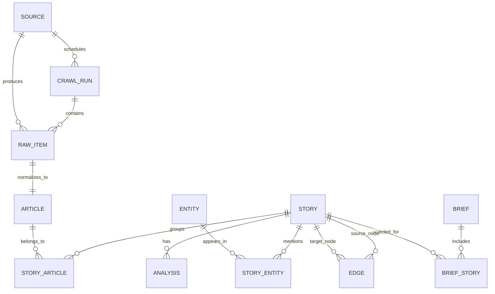

# 数据模型与 API

## 1. 数据原则

- 原始采集结果与分析结果分表保存，AI 结果可重建。
- 所有外部内容必须能追溯到 `source_id` 和原始 URL。
- 故事簇是用户主要消费单位；文章是证据。
- 图谱边是数据库中的显式关系，不由前端临时生成。
- 生产环境不写示例新闻；空状态由 UI 处理。

## 1.1 MVP 数据路径

首版不建立数据库和独立 API 服务。Horizon 生成 `data/export/latest.json`，Next.js 的 route handler 读取该文件并返回本文档定义的响应结构。

```text
Horizon data/export/latest.json
  → web/app/api/brief/route.ts
  → web/app/api/stories/route.ts
  → 前端页面
```

下文的数据表和 REST API 是升级到 Postgres/FastAPI 时的契约。MVP 可以先保持响应字段一致，内部仍读文件。

## 2. 实体关系



## 3. 核心表

### `sources`

| 字段 | 类型 | 说明 |
| --- | --- | --- |
| `id` | uuid | 主键 |
| `name` | text | 展示名 |
| `kind` | enum | `rss` / `api` / `html` |
| `url` | text | 入口地址 |
| `category` | text | 默认分类 |
| `profile` | text | 默认 Profile，可空 |
| `enabled` | bool | 是否启用 |
| `interval_minutes` | int | 采集间隔 |
| `config_json` | jsonb | 适配器配置，不含密钥 |
| `last_success_at` | timestamptz | 最近成功 |
| `last_failure_at` | timestamptz | 最近失败 |
| `failure_count` | int | 连续失败次数 |

### `crawl_runs`

| 字段 | 类型 | 说明 |
| --- | --- | --- |
| `id` | uuid | 主键 |
| `started_at` | timestamptz | 开始时间 |
| `finished_at` | timestamptz | 结束时间 |
| `status` | enum | `queued/running/partial/failed/published` |
| `source_count` | int | 计划来源数 |
| `fetched_count` | int | 抓取条目数 |
| `story_count` | int | 生成故事数 |
| `error_summary` | jsonb | 分来源/阶段错误 |

### `raw_items`

保存适配器原始输出，方便重跑与排查。

| 字段 | 类型 | 说明 |
| --- | --- | --- |
| `id` | uuid | 主键 |
| `run_id` | uuid | 所属运行 |
| `source_id` | uuid | 来源 |
| `external_id` | text | 源内 ID，可空 |
| `title` | text | 原始标题 |
| `url` | text | 原始链接 |
| `summary` | text | 源摘要 |
| `author` | text | 作者/频道 |
| `published_at` | timestamptz | 发布时间，可空 |
| `language` | text | 语言 |
| `raw_payload` | jsonb | 原始条目元数据 |
| `content_text` | text | 正文提取结果，可空 |
| `fetch_status` | enum | `fetched/extract_failed/parse_failed` |

### `articles`

| 字段 | 类型 | 说明 |
| --- | --- | --- |
| `id` | uuid | 主键 |
| `raw_item_id` | uuid | 对应原始条目 |
| `canonical_url` | text | 规范化 URL，唯一索引建议 |
| `title` | text | 清洗后标题 |
| `excerpt` | text | 短摘要（不是全文镜像） |
| `content_hash` | text | 正文/标题指纹 |
| `author` | text | 作者 |
| `published_at` | timestamptz | 发布时间 |
| `language` | text | 语言 |
| `source_id` | uuid | 来源 |

### `stories`

| 字段 | 类型 | 说明 |
| --- | --- | --- |
| `id` | uuid | 主键 |
| `slug` | text | 稳定短标识 |
| `title` | text | 事件标题 |
| `summary` | text | 编辑摘要 |
| `category` | text | 分类 |
| `score` | numeric(3,1) | 0–10 |
| `confidence` | numeric(3,2) | 0–1 |
| `first_seen_at` | timestamptz | 首次出现 |
| `last_seen_at` | timestamptz | 最近出现 |
| `status` | enum | `collecting/analyzed/published/rejected/analysis_failed` |
| `dedup_reason` | jsonb | 合并/聚类依据 |

### `story_articles`

- `story_id`、`article_id` 联合主键。
- `role`：`primary` / `supporting` / `duplicate`。
- `similarity`：模型/算法给出的相似度，可为空。

### `entities`

| 字段 | 类型 | 说明 |
| --- | --- | --- |
| `id` | uuid | 主键 |
| `kind` | enum | `model/company/person/topic/tool` |
| `name` | text | 名称 |
| `canonical_name` | text | 归一化名称 |
| `metadata` | jsonb | 别名、官网等 |

### `story_entities`

- `story_id`、`entity_id`、`role`、`confidence`。
- 允许一个故事关联多个模型、公司和主题。

### `analyses`

| 字段 | 类型 | 说明 |
| --- | --- | --- |
| `id` | uuid | 主键 |
| `story_id` | uuid | 对应故事 |
| `profile` | text | 分析用的 Profile |
| `one_liner` | text | 一句话总结 |
| `key_points` | jsonb | 最多 3 条要点 |
| `why_it_matters` | text | 为什么重要 |
| `risks` | jsonb | 反证/不确定性 |
| `tags` | text[] | 标签 |
| `model` | text | 模型名 |
| `provider` | text | 提供方 |
| `prompt_version` | text | 提示词版本 |
| `input_hash` | text | 输入缓存键 |
| `created_at` | timestamptz | 生成时间 |
| `status` | enum | `ok/analysis_failed` |

### `edges`

| 字段 | 类型 | 说明 |
| --- | --- | --- |
| `id` | uuid | 主键 |
| `source_node_type` | text | `story/entity/source` |
| `source_node_id` | uuid | 源节点 |
| `target_node_type` | text | 同左 |
| `target_node_id` | uuid | 目标节点 |
| `kind` | text | `same_story/similar/mentions/published_by/cites` |
| `weight` | numeric | 0–1 |
| `metadata` | jsonb | 证据和理由 |

### `briefs` 与 `brief_stories`

- `briefs`：`date`、`language`、`headline`、`sections_json`、`status`、`created_at`。
- `brief_stories`：`brief_id`、`story_id`、`section`、`rank`。

### `settings`

首版单用户。保存非敏感设置（语言、时区、动效偏好、来源开关）；API Key 使用环境变量，不保存在数据库明文中。

## 4. 关键枚举

```text
StoryStatus = collecting | analyzed | published | rejected | analysis_failed
RunStatus = queued | running | partial | failed | published
ArticleRole = primary | supporting | duplicate
EdgeKind = same_story | similar | mentions | published_by | cites
Profile = ai-news | research | tooling | industry
```

## 5. REST API

基础路径：`/api/v1`。首版只监听本地或受保护网络；写接口要求 `X-Admin-Token`。

### 读取

#### `GET /health`

返回服务、数据库和调度器状态。不返回密钥。

```json
{
  "status": "ok",
  "database": "ok",
  "scheduler": "running",
  "last_run": "2026-10-27T08:00:00+08:00"
}
```

#### `GET /briefs/:date`

返回指定日期的简报。

```json
{
  "date": "2026-10-27",
  "language": "zh",
  "headline": "今天值得关注的三条 AI 信号",
  "sections": [
    {
      "id": "top3",
      "title": "今日 Top 3",
      "stories": ["story_uuid_1", "story_uuid_2", "story_uuid_3"]
    }
  ],
  "status": "published"
}
```

#### `GET /stories`

查询参数：`date`、`category`、`profile`、`q`、`min_score`、`limit`、`cursor`。

返回故事列表和轻量图谱节点，不返回完整正文。

```json
{
  "items": [
    {
      "id": "story_uuid",
      "title": "示例事件",
      "one_liner": "一句话说明今天发生了什么。",
      "category": "model-release",
      "score": 8.7,
      "source_count": 3,
      "first_seen_at": "2026-10-27T01:15:00Z",
      "status": "published"
    }
  ],
  "next_cursor": null
}
```

#### `GET /stories/:id`

返回故事详情、分析结果、文章证据和引用。若 AI 分析失败，返回 `analysis_status: analysis_failed` 和原始文章，不返回伪造摘要。

#### `GET /stories/:id/graph`

返回以故事为中心的一跳/二跳关系。

```json
{
  "nodes": [
    {"id": "story_uuid", "type": "story", "label": "示例事件", "score": 8.7},
    {"id": "entity_uuid", "type": "entity", "label": "Agent", "kind": "topic"}
  ],
  "edges": [
    {"source": "story_uuid", "target": "entity_uuid", "kind": "mentions", "weight": 0.82}
  ]
}
```

#### `GET /sources`

返回启用来源及健康状态。失败字段必须可见。

### 管理

#### `POST /admin/runs`

手动触发一次抓取；返回 `run_id`。

#### `GET /admin/runs/:id`

返回阶段进度、错误明细和生成结果。

#### `PUT /settings`

更新非敏感设置。模型密钥不接受前端直接写入；通过环境变量或本机安全配置。

#### `POST /stories/:id/regenerate`

重新运行指定故事的分析；记录新的分析和模型版本，不覆盖旧记录。

## 6. 图谱 API 约束

- 一次响应最多 120 个节点、300 条边；超过返回分页或聚合提示。
- 每个节点必须包含 `type`、`label`、`id`；故事节点必须包含 `score`。
- 前端不得根据标题自行添加边；没有后端关系就不画。
- `same_story` 与 `similar` 必须区分，避免把相似主题误当重复报道。

